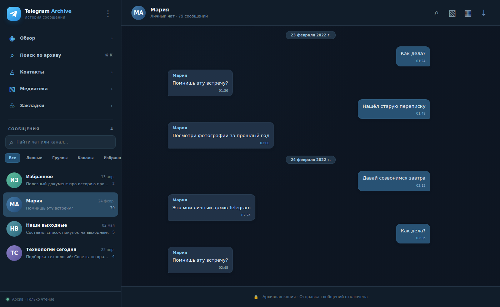
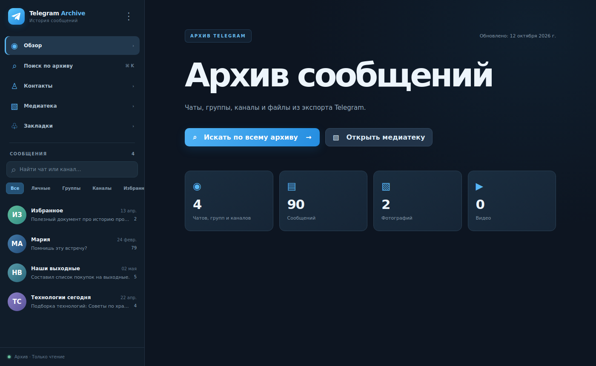
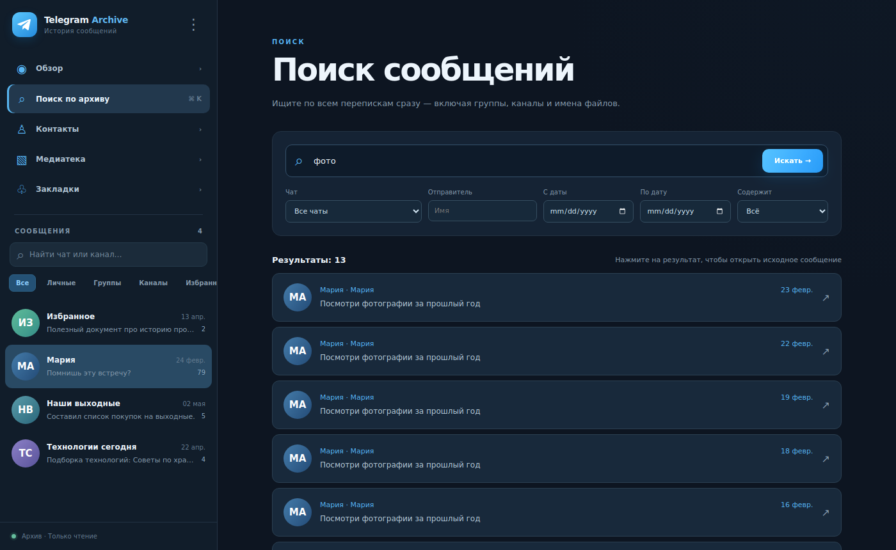
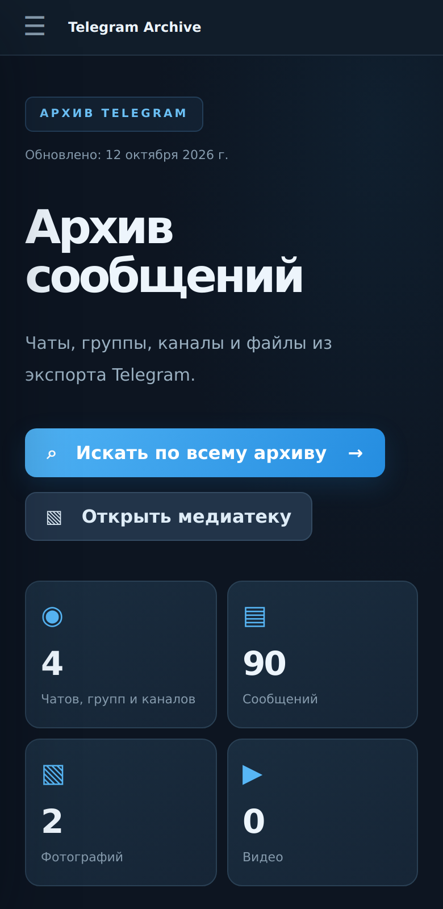

# Telegram Archive Reader

[](https://github.com/berlonak/TelegramArchiveReader/actions/workflows/tests.yml)
[](LICENSE)

**Личная веб-читалка экспорта Telegram Desktop (JSON) с полнотекстовым поиском. Только чтение.**
Укажите папку, которую выгрузил Telegram Desktop, и просматривайте все чаты, группы и каналы,
ищите по всей истории сразу, открывайте фото и видео. Всё работает на вашем компьютере или
сервере. Программа не подключается к Telegram, не использует API и не просит вход в аккаунт.

[English version](README.md)



## Возможности

- **Импорт экспорта Telegram Desktop в формате «Машиночитаемый JSON»**: полный экспорт
  аккаунта (чаты, покинутые чаты, контакты, имя владельца) и экспорт одного чата.
- **Потоковый импорт** через `ijson`: в памяти одно сообщение за раз, поэтому подходит для
  экспортов в десятки гигабайт. Исходные файлы не изменяются.
- **Повторный импорт** более нового экспорта обновляет сообщения без дублей. Если новый
  экспорт выгружен без медиа, найденные ранее вложения сохраняются.
- **Полнотекстовый поиск** (SQLite FTS5, по началу слова) по всем чатам и именам файлов.
  Фильтры: чат, отправитель, период, «содержит фото / видео / голосовое / аудио / файл / ссылку».
- **Просмотр чата**: подгрузка в обе стороны, переход к дате, переход из результата поиска в
  переписку, цитаты ответов с переходом к исходному сообщению.
- **Категории**: личные, группы, каналы, «Избранное» и покинутые чаты.
- **Медиатека**: фото, видео, голосовые, аудио, файлы и стикеры; просмотр в браузере и скачивание.
- **Закладки**, **контакты из экспорта** и **исходный JSON** любого сообщения (все поля
  экспорта сохраняются, даже те, что интерфейс не показывает).
- Тёмная и светлая темы, мобильная вёрстка, `Ctrl/⌘ + K` для поиска.
- **Переносимый пакет**: индекс строится один раз на Windows, готовая папка переносится на
  Linux-сервер без повторной индексации. Есть проверка целостности (SHA-256 `result.json`,
  число и объём файлов) и установщик для Ubuntu/Debian в одну команду.

| Обзор | Поиск | Телефон |
|---|---|---|
|  |  |  |

## Безопасность

- Один пароль архива, хранится как хеш **Argon2id** (не короче 12 символов).
- Cookie сессии `HttpOnly`, `SameSite=Strict`, за HTTPS ещё и `Secure`; в базе хранится только
  SHA-256 токена.
- После 6 неверных попыток вход с этого IP блокируется на 15 минут.
- Строгий Content-Security-Policy, `X-Frame-Options: DENY`, `nosniff`, `no-referrer`,
  `Cache-Control: no-store`, проверка Origin для изменяющих запросов.
- Пути к медиа проверяются на выход за пределы папки и символические ссылки при импорте
  **и** при каждом запросе. Inline показываются только безопасные типы, остальное скачивается.
- Приложение слушает только `127.0.0.1`; доступ из интернета — через nginx с HTTPS.

Пароль и HTTPS защищают веб-доступ, но **не шифруют файлы на диске**. Делайте зашифрованные
резервные копии и не публикуйте экспорт или готовую папку `TelegramArchive-ready`.

## Быстрый старт

Нужен Python 3.10+ (Linux, macOS или Windows).

```bash
git clone https://github.com/berlonak/TelegramArchiveReader.git
cd TelegramArchiveReader
python -m venv .venv
source .venv/bin/activate          # Windows: .venv\Scripts\activate
pip install -e .

tgarchive init                     # задать пароль архива
tgarchive import examples/demo-export   # вымышленные демо-данные или путь к вашему экспорту
tgarchive serve                    # http://127.0.0.1:8000
```

Медиа отдаются из исходной папки экспорта, поэтому не перемещайте её после импорта.
Индекс лежит в `./archive-data/`, если не задана переменная `TGARCHIVE_DATA_DIR`.

**Как выгрузить данные:** Telegram Desktop → *Настройки → Продвинутые настройки → Экспорт
данных из Telegram*, формат **«Машиночитаемый JSON»**. Для одного чата: меню чата →
*Экспорт истории чата* → JSON.

Команды: `init`, `import ПУТЬ`, `serve [--port 8000]`, `change-password`, `stats`, `reindex`.

## Windows: готовый переносимый архив

- **[WINDOWS-RU.md](WINDOWS-RU.md)**: сборка из ОДНОЙ папки экспорта Telegram Desktop и
  локальный запуск.
- `START-HERE.bat`: интерактивная сборка с проверкой пароля до переноса файлов.
  `RESUME-READY.bat` восстанавливает прерванную сборку. `START-LOCAL.bat`,
  `RESET-PASSWORD.bat` и `start-local.py` автоматически попадают в готовый пакет.
- `bundletool.py`: `prepare`, `verify`, `pack` (необязательный один TAR-файл), `activate`
  (при переносе на Linux).

### Диагностика занятой папки

Сборка использует **обычный Move-Item** без hardlinks. После ошибки перемещения скрипт
предлагает диагностику. Её можно запустить и **до сборки**: откройте `CHECK-LOCK.bat`, введите
папку экспорта, согласитесь на запуск от администратора и на загрузку официального Microsoft
Sysinternals Handle. Утилита скачивается только с вашего согласия, у неё проверяется цифровая
подпись Microsoft, и в репозиторий она не входит.

В выводе будут найденные процессы, PID и открытые пути. **Открытый файл не всегда является
причиной запрета на перенос**: доступ может временно блокировать антивирус или настройки
разрешений. Если дескрипторов нет, скрипт честно сообщает, что виновник не установлен.
Процессы автоматически не закрываются. Отчёт сохраняется в `%TEMP%/tgarchive-lock-*.txt`.

При неудачном Move-Item скрипт **не** удаляет ни готовую, ни исходную папку. Перед повторным
запуском проверьте обе директории: Windows могла успеть переместить данные частично.

## Сервер (Ubuntu/Debian, без Docker)

- **[SERVER-RU.md](SERVER-RU.md)**: перенос готовой `TelegramArchive-ready` на сервер,
  публичный IP и автоматический HTTPS (сертификат Let's Encrypt на IP, Certbot 5.4+).
- `deploy/docker/compose.yaml`: необязательный вариант с Docker. Образ содержит только
  приложение, личные медиа остаются на диске.

## Ограничения

- Только чтение. Архив показывает то, что Telegram Desktop включил в JSON. Обратного
  подключения к Telegram и восстановления удалённых до экспорта сообщений нет.
- Сообщения индексируются из JSON. HTML-экспорт в той же папке сохраняется, но не разбирается.
- Контакты — это список на дату экспорта; отсутствие контакта не доказывает его удаление.
- Автотесты проверяют код на искусственных данных. Перед обработкой личного архива сделайте
  независимую резервную копию.

## Тестирование

```bash
pip install -e ".[test]"
python -m pytest -q tests
```

## Лицензия

[Apache License 2.0](LICENSE), см. также [NOTICE](NOTICE).

Независимый проект; не связан с Telegram и не одобрен им.
